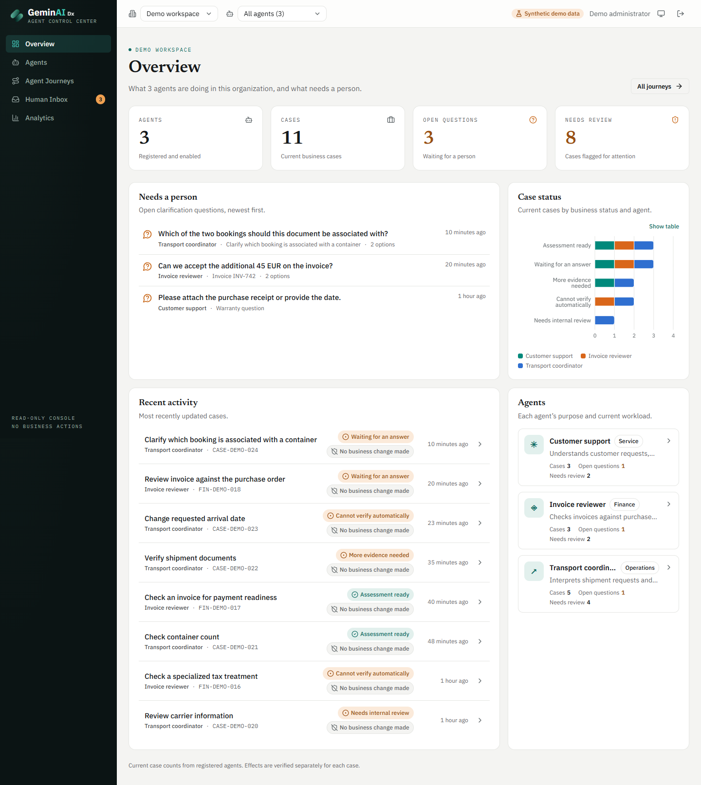

# GeminAI Dx — Agent Control Center (demo)

A business-first, multi-organization, multi-agent control center for GeminAI Dx agents, built with **Next.js 15 (App Router), React 19, TypeScript (strict), Tailwind CSS and shadcn/ui-style components**, using the visual identity of [geminaidx.com](https://www.geminaidx.com/).

> **This repository is a public demo build.**
> - **Sign-in accepts any access key.** The login page is shown, but there is no real authentication.
> - **All data is fictional.** It is a bundled snapshot (`src/lib/server/demo/snapshot.json`) of the synthetic multi-agent demo from the GeminAI Dx agent console. It contains three fictional agents and eleven fictional cases in two demo organizations. No real organization, customer or case is included, and no backend is called.
> - Demo timestamps are shifted forward by whole days at load, so the newest demo activity always looks recent.
> - The app is read-only. Human Inbox answers can be drafted but not submitted.

The production version, with real operator authentication and per-organization agent backends, lives in the private automation repository.



## Deploy to Vercel

1. Import this repository in Vercel. The framework preset **Next.js** is detected automatically.
2. Keep the default build settings: install `npm install`, build `next build`.
3. No environment variables are required. You can optionally set `GDX_CC_SESSION_SECRET` (any string of 32 or more characters) to sign demo session cookies with your own secret.

## Run locally

Requires Node.js 20.9 or later.

```powershell
npm install
npm run dev          # http://localhost:3100, then sign in with any access key
```

## Pages

| Route | Purpose |
| --- | --- |
| `/o/{org}` | **Overview**: agents, cases, open questions, needs-review metrics; status by agent; recent activity |
| `/o/{org}/agents` | **Agents**: search, filter, sort; performance comparison |
| `/o/{org}/agents/{agent}` | **Agent details** |
| `/o/{org}/journeys` | **Agent Journeys**: case list with search, status and attention filters |
| `/o/{org}/journeys/{agent}/{case}` | **Journey**: outcome, eight-question summary, timeline, input, questions, evidence checks, technical details and audit export |
| `/o/{org}/inbox` | **Human Inbox**: questions across agents with full context |
| `/o/{org}/analytics` | **Analytics**: time windows, activity per agent, business effects, comparisons, cross-organization comparison |

## Commands

```powershell
npm run typecheck    # tsc --noEmit (strict)
npm run lint         # next lint
npm test             # vitest
npm run build        # production build
```

## Where the demo wiring lives

| File | Role |
| --- | --- |
| `src/lib/server/demo/data.ts` | Serves the read endpoints (agents, overview, cases, questions, insights, case detail, runs, audit, question context) from the snapshot, including case filtering |
| `src/lib/server/config.ts` | Fixed demo organizations and demo operator |
| `src/app/actions.ts` | Login: any non-empty key signs in as the demo operator |
| `src/lib/server/session.ts` | HMAC-signed session cookie; uses a public fallback secret when `GDX_CC_SESSION_SECRET` is unset |
